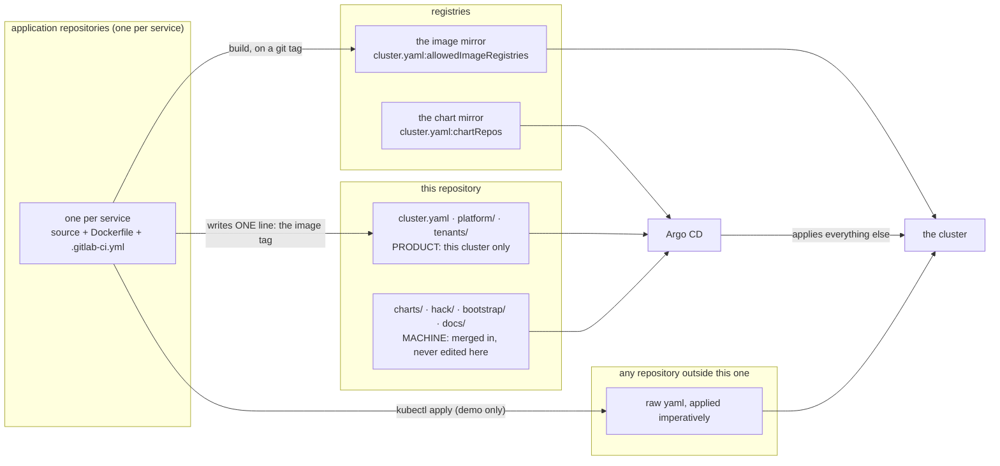
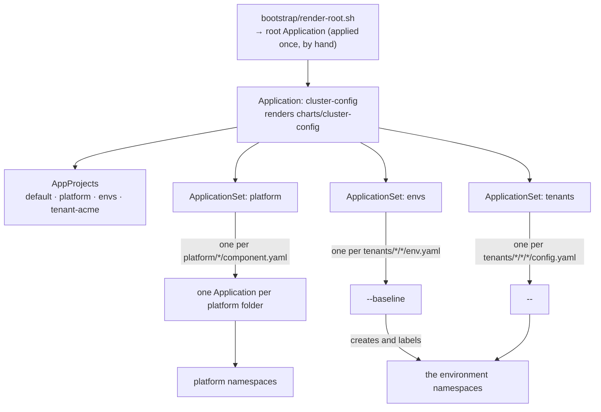
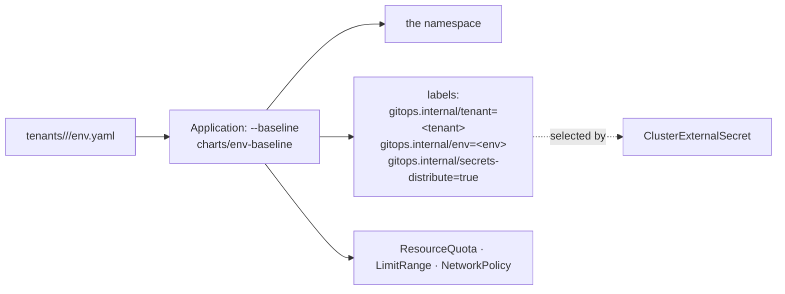
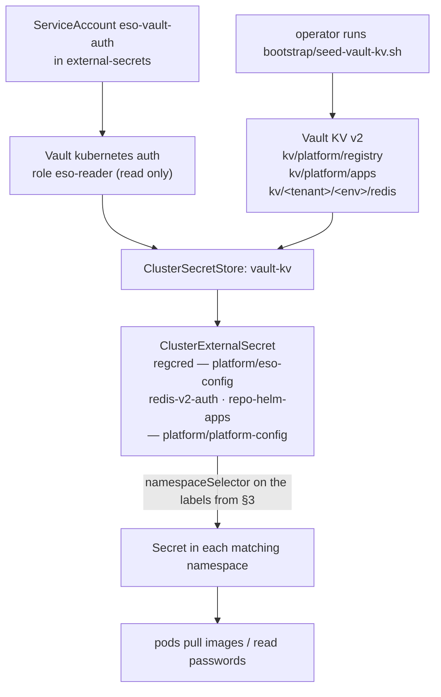
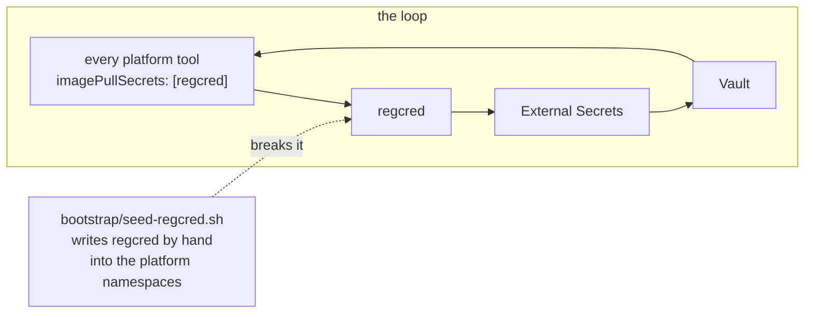
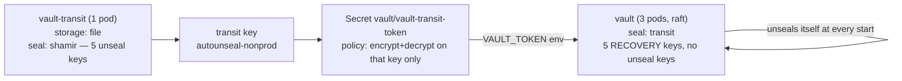
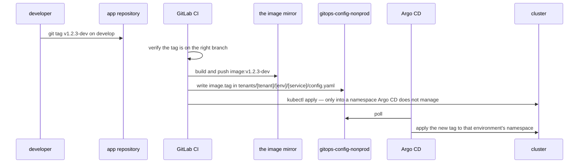

# How it works — the whole thing, end to end

Read this before `docs/10-add-a-tool.md` or `docs/11-add-an-app.md`. Those pages
tell you which files to write. This one tells you what happens to them.

Every diagram here is Mermaid and renders in GitLab.

---

## 1. The four repositories, and which one owns what



The one line an application's pipeline writes into this repository is
`image.tag` in `tenants/<tenant>/<env>/<service>/config.yaml`. Nothing else here is
edited by a machine.

`that namespace` is **not** managed by Argo CD. It predates this structure and is
still driven by `any repository outside this one` and `kubectl apply`. Do not point anything in
this repository at it.

---

## 2. From a folder to a running Application

Nothing in this repository is an Argo CD `Application` object. Folders are, and
ApplicationSets turn them into Applications.



**The folder name is the service name.** `tenants/<tenant>/<env>/<service>/` becomes
the Application `<tenant>-<env>-<service>` and the Helm release `<service>`. Nothing
inside the folder restates the name, so the two cannot drift.

A workload folder is delivered in exactly one of three ways, and `config.yaml`
says which:

| key | means | example |
|---|---|---|
| `chart:` | a chart from a mirror, plus `values.yaml` | every application |
| `manifestsDir:` | plain yaml files applied as they are | `tenants/<tenant>/<env>/<service>/  (the redis folder)` |
| `localChart:` | a chart living in this repository | `platform/pki/` |

---

## 3. Who creates namespaces

One owner, and it is not the workload.



Those labels are not decoration. `secrets-distribute` is what makes External
Secrets copy `regcred` into the namespace; the tenant and env labels are how the
Redis credential finds the right one. A namespace made by hand gets none of
them and silently receives no secrets.

The platform namespaces (`vault`, `cert-manager`, …) come from
`cluster.yaml:platformNamespaces` and are created by the platform
ApplicationSet with `CreateNamespace=true`. They deliberately do **not** carry
`secrets-distribute` — see section 5.

---

## 4. How a secret gets into a namespace



Three things about this chain are worth knowing before it breaks:

**`Valid` on the store means Vault answered, not that a secret was read.** The
evidence is a Secret appearing in a namespace nobody created it in.

**`SecretSynced` does not mean the credential works.** This cluster once held
`username: <mirror-user>` and reported `Ready=True SecretSynced` for hours. The
proof is in `docs/05-vault-eso.md` under "Proving the credential".

**A `ClusterExternalSecret` that matches no namespace reports `Ready`.** Nothing
is wrong from its point of view; it did everything it was asked.

---

## 5. The bootstrap loop, and why two things are imperative



Vault, External Secrets and everything else pull from the private mirror, and
the pull secret comes from Vault through External Secrets. Nothing in git can
break that circle, so two things are applied by hand, on purpose, and stay that
way:

| what | by | why |
|---|---|---|
| `regcred` in the platform namespaces | `bootstrap/seed-regcred.sh` | ESO cannot start without it |
| Argo CD's own git credential | `bootstrap/repo-credentials.example.yaml` | it is what Argo uses to read this repository — sourcing it from Vault means a bad rotation takes away the commit that would fix it |

Tenant namespaces are different: they carry `secrets-distribute` and get
`regcred` from Vault like everything else.

---

## 6. Why Vault needs a second Vault



The main Vault unseals itself by asking the transit Vault to decrypt its master
key. That is why a node reboot needs no human.

**The consequence, which costs a Vault:** rebuild the
transit Vault and its key is gone. A new key with the same name is a different
key. Every Vault it sealed is then initialised, sealed and unopenable, and the
recovery keys do not help — they authorise `generate-root` and `rekey` on a
Vault that is already open. A transit-sealed Vault has no unseal keys at all.

**Transit and the Vaults it seals are rebuilt together, transit first, or not at
all.** `bootstrap/vault-day0.sh` says so while it runs and refuses to call a
sealed Vault up.

The transit Vault is itself sealed with Shamir and its five unseal keys are the
only way to open it after a restart -- **every** restart, and that is the part
that costs time rather than data. A node reboot, a drain, an eviction or a
Longhorn volume reattaching all bring it back sealed, the main Vault carries on
serving because it only needs transit at startup, and the cluster looks perfect
until a main Vault pod restarts and cannot open. `bootstrap/unseal-transit.sh`
is the answer to that and `docs/30-incident.md` section 7 is when to run it. It is `automated: false` in Argo CD for the
same reason: init and unseal are a ceremony, and a sync in the middle of one is
not a fix.

---

## 7. A change, from a developer's keyboard to a pod



`-dev` and `-qa` are the whole promotion model. The tag decides the environment,
and `verify_branch` in each pipeline refuses a `-qa` tag that is not on the `qa`
branch.

`the environment closest to production is `automated: true`, so what CI writes is applied. Hold one service
back by setting `automated: false` in its `config.yaml` — visible in the
Application list, which a held promotion otherwise is not.

---

## 8. The four gates

Run before every push. None reaches the internet.

```bash
python3 hack/validate.py && ./hack/prove-checks.sh && ./hack/check-pins.sh && ./hack/render.sh
```

| gate | asks |
|---|---|
| `validate.py` | do the files say something consistent and allowed |
| `prove-checks.sh` | does every check actually refuse what it claims to — it breaks each rule on purpose |
| `check-pins.sh` | is every image and chart pinned to an exact version |
| `render.sh` | does what the files produce actually render, and is the result something the API server will hold |

`prove-checks.sh` is the unusual one and it is the reason the rest can be
trusted: a check that matches nothing passes silently and looks exactly like
coverage, on every run, indefinitely.

**When you add a check, add its case in the same commit.** See
`docs/20-gates.md`.

---

## 9. Where everything lives

| path | what | class |
|---|---|---|
| `cluster.yaml` | the truth about this one cluster: registries, chart mirrors, tenants, namespaces | product |
| `platform/<tool>/` | one cluster tool: `component.yaml`, `values.yaml`, `images.yaml`, `RUNBOOK.md` | product |
| `tenants/<t>/<env>/env.yaml` | one environment: namespace, quotas, network profile | product |
| `tenants/<t>/<env>/<svc>/` | one workload: `config.yaml` + `values.yaml` | product |
| `charts/cluster-config` | the AppProjects and the three ApplicationSets | machine |
| `charts/env-baseline` | namespace, labels, quota, limits, policy | machine |
| `platform/platform-config/chart/` | the ClusterExternalSecrets for the Helm and Redis credentials. A `localChart`, so it lives under `platform/` and is **product** | product |
| `platform/eso-config/manifests/` | the ClusterSecretStore, and the `regcred` distribution to every tenant namespace | product |
| `hack/` | the four gates, plus the five tools that are not gates | machine |
| `bootstrap/` | everything a human runs once: Argo CD, `regcred`, the Vault ceremony, Vault day-1 | machine |
| `docs/` | these pages | machine |

---

## 10. Where to go next

| you want to | read |
|---|---|
| add an application | `docs/11-add-an-app.md` |
| remove an application | `docs/13-remove-something.md` |
| add a cluster tool | `docs/10-add-a-tool.md` |
| add an environment | `docs/12-add-an-environment.md` |
| configure Vault for a new cluster | `docs/05-vault-eso.md` |
| understand a refusal from the gate | `docs/20-gates.md` |
| **something is broken right now** | `docs/30-incident.md` |
