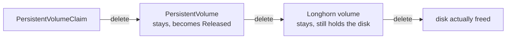

# Removing an application, a tool, or an environment

Adding is one folder. Removing is one folder **and a decision about what it
owns**, which is why this is its own page.

---

## The one thing to establish first

Does the folder own storage?

```bash
grep -l 'stateful: true' tenants/*/*/*/config.yaml platform/*/component.yaml
```

```bash
kubectl -n <namespace> get pvc
```

If the answer is yes, read section 4 before deleting anything. `prune: true` on
a stateful workload is how its PersistentVolumeClaims get deleted, and
`git revert` does not bring data back. `hack/validate.py` refuses that
combination in the repository; it cannot refuse it on a cluster.

---

## 1. A stateless application

```bash
git rm -r tenants/<tenant>/<env>/<service>
```

```bash
python3 hack/validate.py && ./hack/render.sh
```

Commit with a product subject — one folder per commit, or the shelf test refuses
it:

```bash
git commit -m "orders dev: removed, <why>"
```

What happens on push: the `tenants` ApplicationSet stops generating
`acme-dev-orders`. Because every ApplicationSet here sets
`preserveResourcesOnDeletion: true`, **the Application object goes and the
Deployment, Service and HTTPRoute stay running.**

That is deliberate: a folder removed by a bad rebase should not take a service
down. It also means removal is not finished until you say so:

```bash
kubectl -n <namespace> delete deployment,service,httproute -l app.kubernetes.io/instance=orders
```

Check what the label actually is before trusting that line:

```bash
kubectl -n <namespace> get deploy --show-labels
```

If you skip this, the workload runs forever with nothing in git describing it —
the worst of both models.

---

## 2. Also remove it from CI

The application's own pipeline writes `image.tag` into the folder you just
deleted. Leave it and the next `-dev` tag fails with:

```
ERROR: tenants/<tenant>/<env>/<service>/config.yaml does not exist in gitops-config-nonprod
```

Loud, which is right, and still a broken pipeline. Remove the `deploy` job's
GitOps block from that repository in the same change, or remove the service from
both environments at once.

---

## 3. A cluster tool

```bash
git rm -r platform/redis-operator
```

Three extra checks, in this order:

**Does anything depend on it?**

```bash
grep -rn 'requires:' platform/*/component.yaml
```

A `requires:` naming a folder that is gone is refused by the gate, so this
cannot reach a cluster — but it means your one-folder commit is now two, and
they have to be ordered: dependents first.

**Does it own cluster-scoped kinds?** If it appears in
`cluster.yaml:platformClusterResources`, that list is derived and
`hack/validate.py` will tell you it is stale. Remove the entry in the same
change.

**Does it own CRDs?** Namespace deletion does not remove them, and removing them
deletes every object of that kind **cluster-wide**, including in namespaces this
repository does not manage.

```bash
kubectl get crd -o name | grep <the tool's api group>
```

```bash
kubectl get <kind> -A
```

Read the second output in full before deleting a CRD. In a typical estate
`that namespace`, `apisix`, `sonarqube` and `portainer` are not managed here and
their objects would go too.

---

## 4. Anything with storage

Deleting a PVC is three layers, not one, because `longhorn` has
`reclaimPolicy: Retain` on this cluster:



Stop at layer one and the disk is still occupied by something no PVC can ever
bind to. They accumulate silently, and the symptom is not
"disk full" — it was a 2Gi volume that would not attach, with 94GB free:

```
insufficient storage: disk ... does not have enough storage available
```

Longhorn schedules against `storageScheduled`, not `storageAvailable`. Every
volume reserves its full size on every node holding a replica, written or not.

```bash
kubectl -n longhorn-system get nodes.longhorn.io -o "custom-columns=NODE:.metadata.name,MAX:.status.diskStatus['<disk-id>'].storageMaximum,AVAIL:.status.diskStatus['<disk-id>'].storageAvailable,SCHEDULED:.status.diskStatus['<disk-id>'].storageScheduled"
```

`SCHEDULED` above `MAX` means nothing new can be placed, whatever `AVAIL` says.

### Finding what is orphaned, safely

```bash
kubectl -n longhorn-system get volumes.longhorn.io -o custom-columns=NAME:.metadata.name,STATE:.status.state,SIZE:.spec.size,NS:.status.kubernetesStatus.namespace,PVC:.status.kubernetesStatus.pvcName,PV:.status.kubernetesStatus.pvName
```

`status.kubernetesStatus` survives the PV, so every orphan still says which
namespace it belonged to. **Read the `NS` column line by line.** A volume with
`STATE: attached` is in use by something right now — leave it.

Delete by **explicit name**, never by a pattern:

```bash
kubectl -n longhorn-system delete volumes.longhorn.io pvc-aaaa... pvc-bbbb...
```

A `grep detached | xargs delete` takes any volume that happens to be detached
at that moment, including one belonging to a namespace nobody here manages.

---

## 5. An environment

```bash
git rm -r tenants/<tenant>/<env>
```

Remove it from `cluster.yaml:tenants` in the same change — the gate refuses the
two disagreeing. Everything in section 1 applies to every workload that was in
it, and the namespace itself stays, because `env-baseline` created it and
`preserveResourcesOnDeletion` keeps it.

```bash
kubectl delete namespace <namespace>
```

That line deletes every PVC in it, which is section 4 with no warning attached.
Establish what has storage first.

---

## 6. After any removal

```bash
kubectl get applications -A
```

An Application that is still listed after its folder is gone means the
ApplicationSet has not reconciled yet, or the name does not match the folder you
deleted. Both are worth a second look before you start deleting objects by hand.
